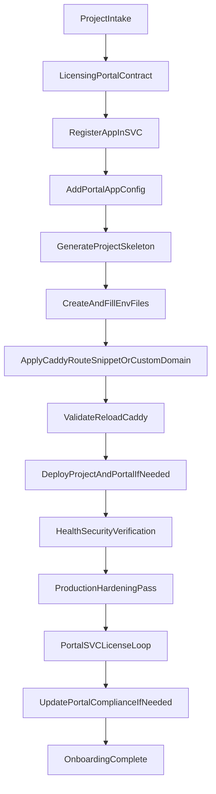

# Project Addition Workflow

**Last Updated:** 2026-06-07

## Workflow Steps

1. Intake project metadata, pricing/trial requirements, and main URL model.
2. Decide Portal + SVC integration details (`appId`, plans, web vs desktop launch).
3. Register the app in SVC (admin UI or API) and save `LICENSE_SERVER_APP_API_KEY`.
4. Add Portal app config (`store.graspvisual.com/{appId}` landing + pricing).
5. Generate project skeleton via `generate-new-project.sh`.
6. Create real env files (including licensing vars) and sync `.env` if present.
7. Apply generated Caddy snippet or custom-domain routing to `Caddyfile`.
8. Validate + reload Caddy.
9. Deploy the product (and Portal if Portal config changed).
10. Verify health, routing, compose secrets, and public surface scripts.
11. Apply [PRODUCTION_HARDENING_PASS.md](PRODUCTION_HARDENING_PASS.md) before customer launch (patched images: [../setup/HARDENED_IMAGES.md](../setup/HARDENED_IMAGES.md)).
12. Verify Portal pages and SVC license checks end to end.
13. Update Portal compliance pages if needed.

## Required Artifacts

- Generated project files in `/vps/environments/<env>/projects/<project>`
- SVC app registration + `LICENSE_SERVER_APP_API_KEY` in product env
- Portal app config in `portal/src/config/apps/<appId>.ts`
- Caddy snippet file(s): `caddy.<env>.snippet.txt` or custom-domain site block
- Updated `Caddyfile` route blocks
- Hardened compose (post baseline deploy) for production
- Deployment + verification evidence for product, Portal, and SVC integration

## Related

- [ADDING_NEW_PROJECTS.md](ADDING_NEW_PROJECTS.md)
- [LICENSING_AND_STORE_INTEGRATION.md](LICENSING_AND_STORE_INTEGRATION.md)
- [PRODUCTION_HARDENING_PASS.md](PRODUCTION_HARDENING_PASS.md)
- [../setup/HARDENED_IMAGES.md](../setup/HARDENED_IMAGES.md)
