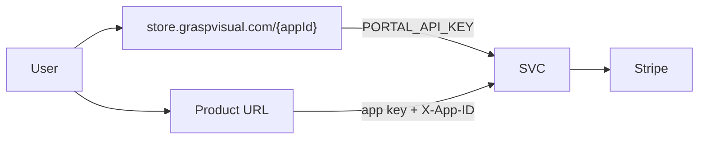

# VPS System Overview

**Audience:** Anyone onboarding a new product to this VPS (developers, agents, VPS admins)  
**Last Updated:** 2026-10-31

Read this first, then follow the linked guides. For the **live project list** (kept in sync with the repo), see [VPS_PROJECTS_REGISTRY.md](VPS_PROJECTS_REGISTRY.md). Host map with diagrams: [/vps/README.md](/vps/README.md).

---

## What this VPS is

A single Linux host (Ubuntu 22.04, 2 vCPU, 8 GB RAM, 100 GB NVMe) running **multiple isolated product stacks** behind one **Caddy** reverse proxy, with shared **Portal** (store/marketing) and **SVC** (licensing) platform services, plus Grafana/Loki/Promtail.

Production is the only environment with product containers. `app-test` / `app-dev` are HTTPS landing pages.

---

## Mental model: shared vs isolated

| Shared (platform) | Isolated (each product) |
|-------------------|-------------------------|
| Caddy TLS and routing | Docker containers for your app |
| Portal at `store.graspvisual.com` | Project Docker network (e.g. `{project}-prod-network`) |
| SVC at `app.graspvisual.com/svc/*` | Your Postgres/Redis volumes and credentials |
| Monitoring (Grafana/Loki/Promtail at `/grafana/*`) — [../setup/MONITORING.md](../setup/MONITORING.md) | Your `env.production` (or `.env`) secrets |
| Stripe webhooks (handled in SVC) | Your deploy boundary (`deploy.sh`, compose) |

**Products do not share a database with each other.** SVC stores **license** data per registered `app_id` (separate app DBs inside SVC). Your application database is in **your** compose stack.

**Products should not talk to each other over the Docker network** — each project gets its own project network; only the reverse proxy joins environment networks to route traffic. License checks: product API → `svc-api-prod:4001` on `production-network`.

Details: [SECURITY_FOR_NEW_APPS.md](SECURITY_FOR_NEW_APPS.md), [../setup/MULTI_ENV_ARCHITECTURE.md](../setup/MULTI_ENV_ARCHITECTURE.md).

---

## Request flow (licensed product)



```text
User
  ├─► store.graspvisual.com/{appId}     Portal (landing, pricing, POST email-gated download)
  │         └─► SVC (PORTAL_API_KEY)    trials, checkout, subscription state, customer portal URLs
  │
  └─► main product URL                  your app (path or custom domain)
            └─► SVC (app key + X-App-ID) license checks in your backend
```

Full procedure: [LICENSING_AND_STORE_INTEGRATION.md](LICENSING_AND_STORE_INTEGRATION.md).

---

## What is deployed today

**Do not guess** — use [VPS_PROJECTS_REGISTRY.md](VPS_PROJECTS_REGISTRY.md) for tables and run:

```bash
/vps/scripts/verify-projects-registry.sh
```

Summary as of 2026-10-31 (all listed HTTPS checks returned 200):

- **Platform:** `svc`, `portal`
- **Licensed products:** `etp`, `growplan`, `timekeeper`
- **Marketing / staging sites:** `tasquantum` (`www.tasquantum.com`), `abpd` (`abpd.graspvisual.com`)
- **Edge / internal:** `trading-bot-relay`, `party-captions-bot` (+ static join under certbot-webroot)
- **Portal-only (not a VPS product deploy):** `gantry` (`visibility: hidden`)

Routing patterns: path-based on `app.graspvisual.com`, custom domains (`growplan.app`, `time.graspvisual.com`, `www.tasquantum.com`, `abpd.graspvisual.com`), platform domain `store.graspvisual.com`.

Host-level extras (WireGuard, ASA-edge UDP DNAT) are documented in [../setup/HOST_EDGE.md](../setup/HOST_EDGE.md) — they are not product onboarding.

---

## Two onboarding paths

### A. Licensed / commercial product (default for customer-facing apps)

Requires Portal + SVC + product deploy:

1. [VPS_PROJECTS_REGISTRY.md](VPS_PROJECTS_REGISTRY.md) — confirm naming; plan row for new project  
2. [LICENSING_AND_STORE_INTEGRATION.md](LICENSING_AND_STORE_INTEGRATION.md) — SVC registration, Portal app config, env vars  
3. [../QUICK_REFERENCE_ADDING_PROJECTS.md](../QUICK_REFERENCE_ADDING_PROJECTS.md) — generate, deploy, verify  
4. [PRODUCTION_HARDENING_PASS.md](PRODUCTION_HARDENING_PASS.md) — before customer launch  
5. Update [VPS_PROJECTS_REGISTRY.md](VPS_PROJECTS_REGISTRY.md) + run `verify-projects-registry.sh`

### B. Internal / no storefront

Skip Portal store pages and SVC registration if the product has **no** trials, subscriptions, or public store presence. Still follow:

- [ADDING_NEW_PROJECTS.md](ADDING_NEW_PROJECTS.md)  
- [PROJECT_STANDARDS.md](PROJECT_STANDARDS.md)  
- [SECURITY_FOR_NEW_APPS.md](SECURITY_FOR_NEW_APPS.md)  
- [PRODUCTION_HARDENING_PASS.md](PRODUCTION_HARDENING_PASS.md) for production  

`trading-bot-relay` and `party-captions-bot` are this path.

---

## Read order (new project)

| Step | Document |
|------|----------|
| 0 | **This file** — `VPS_SYSTEM_OVERVIEW.md` |
| 1 | [VPS_PROJECTS_REGISTRY.md](VPS_PROJECTS_REGISTRY.md) — what exists today |
| 2 | [AGENT_INTEGRATION_PACKAGE.md](AGENT_INTEGRATION_PACKAGE.md) or [../new-projects-template/integration/AGENT_INTEGRATION_PACKAGE.md](../new-projects-template/integration/AGENT_INTEGRATION_PACKAGE.md) in copied package |
| 3 | [PROJECT_STANDARDS.md](PROJECT_STANDARDS.md) + [SECURITY_FOR_NEW_APPS.md](SECURITY_FOR_NEW_APPS.md) |
| 4 | Licensed? → [LICENSING_AND_STORE_INTEGRATION.md](LICENSING_AND_STORE_INTEGRATION.md) |
| 5 | On VPS → [../QUICK_REFERENCE_ADDING_PROJECTS.md](../QUICK_REFERENCE_ADDING_PROJECTS.md) |
| 5b | Custom domain? → [CUSTOM_DOMAIN_AND_TLS.md](CUSTOM_DOMAIN_AND_TLS.md) |
| 5c | Non-default compose? → [NON_STANDARD_COMPOSE_LAYOUTS.md](NON_STANDARD_COMPOSE_LAYOUTS.md) |
| 5d | Platform logs/metrics? → [../setup/MONITORING.md](../setup/MONITORING.md) (VPS admin; Grafana at `app.graspvisual.com/grafana/`) |
| 5e | Patched Postgres/Redis bases? → [../setup/HARDENED_IMAGES.md](../setup/HARDENED_IMAGES.md) |
| 6 | Before launch → [PRODUCTION_HARDENING_PASS.md](PRODUCTION_HARDENING_PASS.md) |
| 7 | After deploy → [BACKUPS_FOR_NEW_PROJECTS.md](BACKUPS_FOR_NEW_PROJECTS.md) |

**Copied package for local repos:** copy `docs/new-projects-template` → `docs/vps-integration` (see [../new-projects-template/COPY_TO_PROJECT.md](../new-projects-template/COPY_TO_PROJECT.md)).

**One-page runbook:** [NEW_PROJECT_ONBOARDING_RUNBOOK.md](NEW_PROJECT_ONBOARDING_RUNBOOK.md).

---

## Key scripts

| Script | Purpose |
|--------|---------|
| `generate-new-project.sh` | Scaffold compose, env examples, Caddy snippets |
| `deploy.sh` | Deploy to production/testing/development |
| `health-check.sh` | Per-project health |
| `verify-compose-secrets.sh` | Secret handling in compose definitions |
| `verify-runtime-secrets.sh production` | Runtime container secret presence after deploy |
| `check-public-surface.sh` | Unexpected public ports |
| `verify-all-projects.sh` | Broader project verification |
| `verify-projects-registry.sh` | Registry vs live projects/Portal |
| `sync-template-package.sh` | Refresh `docs/new-projects-template` |
| `verify-env-files.sh` | Env file presence / required vars per project |
| `backup.sh` | Per-project encrypted backup (see BACKUPS doc) |

**Env files:** [../setup/ENV_FILES_SETUP.md](../setup/ENV_FILES_SETUP.md) — validate with `docker compose --env-file env.production config` before deploy (Portal/party-captions-bot use `.env`).

---

## Related

- [README.md](README.md) — integration doc index  
- [../../README.md](../../README.md) — host README (as-built map)  
- [../architecture/AS_BUILT_REFERENCE.md](../architecture/AS_BUILT_REFERENCE.md) — as-built runtime, federated admin model, internal API contract  
- [../architecture/PLATFORM_ARCHITECTURE_GAP_ANALYSIS.md](../architecture/PLATFORM_ARCHITECTURE_GAP_ANALYSIS.md) — gap analysis and phased evolution  
- [../setup/VPS_STACK_STRUCTURE.md](../setup/VPS_STACK_STRUCTURE.md) — folders and platform vs product  
- [../setup/REVERSE_PROXY.md](../setup/REVERSE_PROXY.md) — Caddy routing and Grafana edge auth  
- [../setup/MONITORING.md](../setup/MONITORING.md) — Grafana/Loki/Promtail ops and LogQL  
- [../setup/HARDENED_IMAGES.md](../setup/HARDENED_IMAGES.md) — Postgres/Redis/Grafana patched bases  
- [../setup/HOST_EDGE.md](../setup/HOST_EDGE.md) — UFW, Fail2ban, WireGuard, ASA-edge  
- [../new-projects-template/README.md](../new-projects-template/README.md) — copyable package
