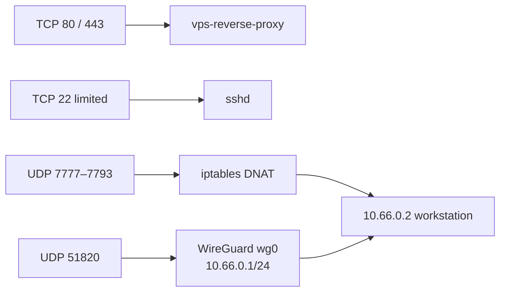

# Host-edge services (not Docker Compose)

**Last verified:** 2026-10-31  
**Audience:** VPS admins. Product onboarding does **not** need this file.

These services run on the Ubuntu host, not under `environments/*/projects/`. A `docker compose restart` does not change them. They are easy to miss because most of the config is **outside** this git tree (`/etc/wireguard`, live `iptables`, UFW).

Related: [REVERSE_PROXY.md](REVERSE_PROXY.md) (Caddy), [../security/FAIL2BAN_SETUP.md](../security/FAIL2BAN_SETUP.md), [MULTI_ENV_ARCHITECTURE.md](MULTI_ENV_ARCHITECTURE.md).

---

## What is on the public NIC



UFW default: deny incoming, allow outgoing, deny routed. Extra allows that are **not** the generic HTTP stack:

| Port | Proto | Purpose (from UFW comments / live NAT) |
|------|--------|----------------------------------------|
| 22/tcp | TCP | SSH (`LIMIT` globally; explicit allow from the gv-workstation IPv4/IPv6) |
| 80, 443 | TCP | Caddy |
| 51820 | UDP | WireGuard (`asa-edge wireguard`) |
| 7777–7793 | UDP | ASA-edge game DNAT to the WireGuard peer |
| 19478, 19479/tcp | TCP | Party Captions socat rollback, **from `172.20.0.0/16` only** (not public) |

---

## WireGuard (`wg0`)

| Item | Live value (2026-10-31) |
|------|-------------------------|
| Interface | `wg0` |
| Listen | UDP **51820** |
| VPS address | `10.66.0.1/24` |
| Peer | `10.66.0.2/32` (workstation tunnel; UFW SSH comment `gv-workstation`) |
| Host config | `/etc/wireguard/wg0.conf` (not in this repo) |

Confirm without dumping keys:

```bash
ip link show wg0
sudo wg show
sudo grep -E '^(Address|ListenPort|AllowedIPs|\[)' /etc/wireguard/wg0.conf
```

Do not commit `wg0.conf`, private keys, or PSKs into `/vps`.

---

## ASA-edge UDP forward

Public UDP **7777–7793** is DNATed to `10.66.0.2` (the WireGuard peer), with matching FORWARD accepts `eth0 → wg0`. This is a **host iptables** path for an ASA game server on the workstation, not a container in this repo.

```bash
sudo iptables -t nat -S | grep 'dport 7777'
sudo iptables -S | grep 'dport 7777'
```

If the tunnel is down, those UDP ports still open on the VPS but have nowhere to go. They are unrelated to Caddy or product compose.

---

## Fail2ban

Host jails (live `fail2ban-client status`, 2026-10-31): `sshd`, `caddy-botsearch`, `caddy-ratelimit`, `recidive`.

Repo copies of jail/filter snippets live under `/vps/infrastructure/host/fail2ban/`. Sync onto the OS with `/vps/scripts/sync-fail2ban-config.sh` (see [SCRIPT_USAGE_GUIDE.md](../maintenance/SCRIPT_USAGE_GUIDE.md)).

---

## What this is not

- Not a substitute for product firewalling inside compose (published ports should stay localhost or unpublished).
- Not covered by `deploy.sh` or `backup-all-production.sh` app backups. Treat `/etc/wireguard` and live iptables as host state that needs its own recovery plan.
- Party Captions **live** traffic uses the `party-captions-bot` container on `production-network`. The UFW 19478/19479 rules are for the **socat rollback** compose under `environments/production/projects/party-captions/` (those containers were stopped as of this verification).
