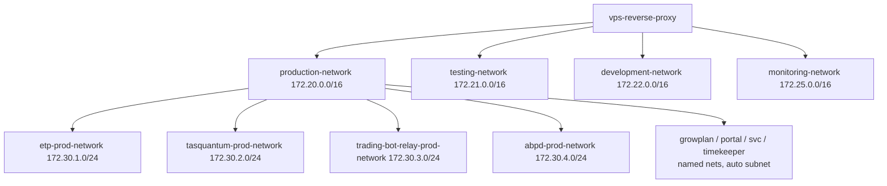

# Multi-Environment VPS Architecture Documentation

**Last Updated:** 2026-10-31  
**VPS Specs:** 2 vCPU, 8GB RAM, 100GB NVMe (Ubuntu 22.04.5; no swap)  
**Architecture:** Multi-project, multi-environment with complete isolation  
**Live map:** [../../README.md](../../README.md) · [VPS_STACK_STRUCTURE.md](VPS_STACK_STRUCTURE.md) · [../integration/VPS_PROJECTS_REGISTRY.md](../integration/VPS_PROJECTS_REGISTRY.md)

---

## Table of Contents

1. [Architecture Overview](#architecture-overview)
2. [Directory Structure](#directory-structure)
3. [Network Architecture](#network-architecture)
4. [Environment Isolation](#environment-isolation)
5. [Security Implementation](#security-implementation)
6. [Resource Management](#resource-management)
7. [Deployment Procedures](#deployment-procedures)
8. [Adding New Projects](#adding-new-projects)
9. [Troubleshooting](#troubleshooting)

---

## Architecture Overview

This VPS architecture supports hosting multiple projects across three isolated environments. **As of 2026-10-31 only production has product containers.** Testing and development hosts are live HTTPS landing pages (`app-test.graspvisual.com`, `app-dev.graspvisual.com`) with no app stacks deployed.

- **Production**: Live applications serving real users (all current products)
- **Testing**: Reserved; landing page only
- **Development**: Reserved; landing page only (HTTPS is live — not optional HTTP)

### Key Features

- **Complete Environment Isolation**: Separate Docker networks prevent cross-environment communication
- **Project Isolation**: Each project runs in its own network namespace
- **Centralized Reverse Proxy**: Single Caddy instance routes traffic to all environments
- **Resource Limits**: CPU and memory constraints prevent resource exhaustion
- **Security Hardening**: Firewall rules, network segmentation, and access controls
- **Automated Operations**: Scripts for deployment, backup, and health checks

---

## Directory Structure

```
/vps/
├── environments/
│   ├── production/projects/     # etp, svc, portal, growplan, timekeeper,
│   │                            # tasquantum, abpd, trading-bot-relay,
│   │                            # party-captions, party-captions-bot
│   ├── testing/projects/        # growplan/env.testing.example only
│   └── development/projects/    # empty
├── projects/                    # app source (see projects/README.md)
├── infrastructure/
│   ├── reverse-proxy/           # Caddyfile, ssl/, certbot-webroot/
│   ├── monitoring/              # Grafana, Loki, Promtail
│   ├── images/                  # patched postgres / redis8 / grafana
│   └── host/fail2ban/
├── scripts/
├── templates/new-project-template/
├── docs/
├── reports/
└── backups/
```

Canonical tree: [VPS_STACK_STRUCTURE.md](VPS_STACK_STRUCTURE.md).

---

## Network Architecture

### Docker Networks

Three environment-level networks provide isolation (all exist on the host even when unused):

- **production-network** (172.20.0.0/16)
- **testing-network** (172.21.0.0/16)
- **development-network** (172.22.0.0/16)

A fourth platform network isolates monitoring from product containers:

- **monitoring-network** (172.25.0.0/16) — Grafana, Loki, and Promtail only. Caddy joins this network (in addition to the three environment networks) to proxy `/grafana/*` without placing Grafana on `production-network`. Product containers cannot reach `vps-grafana:3000` directly. See [MONITORING.md](MONITORING.md).

**Project networks are separate from environment `/16`s.** The generator pins `172.30.<project-number>.0/24`. Live pinned values (2026-10-31):

| Network | Subnet |
|---------|--------|
| `etp-prod-network` | `172.30.1.0/24` |
| `tasquantum-prod-network` | `172.30.2.0/24` |
| `trading-bot-relay-prod-network` | `172.30.3.0/24` |
| `abpd-prod-network` | `172.30.4.0/24` |

GrowPlan (`172.23.0.0/16`), Portal (`172.19.0.0/16`), SVC (`172.18.0.0/16`), and Timekeeper (`timekeeper_default` `172.27.0.0/16`) use Docker auto-assigned ranges — not `172.30.*`. Do not assume ETP lives at `172.20.1.0/24`; that older layout is gone.



### Network Isolation Strategy

1. **Environment Networks**: Prevent cross-environment communication
2. **Project Networks**: Isolate projects within the same environment
3. **Reverse Proxy**: Joins all three environment networks plus `monitoring-network` for routing only (not for app-to-app traffic)
4. **Firewall Rules**: Additional host-level blocking of inter-environment traffic

---

## Environment Isolation

### Production Environment

- **Domain**: `app.graspvisual.com` (and future projects)
- **SSL**: Let's Encrypt production certificates
- **Resource Allocation**: 60% (1.2 CPU, ~5GB RAM)
- **Logging**: Centralized, retained for compliance
- **Backups**: Daily automated backups
- **Access**: Restricted, production credentials

### Testing Environment

- **Domain**: `app-test.graspvisual.com`
- **SSL**: Production Let's Encrypt cert (HTTPS landing page)
- **Deployed projects**: none
- **Resource Allocation**: unused (do not count 25% of the box as reserved while empty)

### Development Environment

- **Domain**: `app-dev.graspvisual.com`
- **SSL**: Production Let's Encrypt cert (HTTPS landing page; HTTP redirects to HTTPS)
- **Deployed projects**: none
- **Resource Allocation**: unused while empty

---

## Security Implementation

### Firewall Configuration

UFW firewall configured with:
- Default deny incoming, deny routed
- SSH: global `LIMIT` plus explicit allow from the gv-workstation
- HTTP/HTTPS (ports 80, 443)
- Extra host services (not product compose): WireGuard UDP 51820, ASA-edge UDP 7777–7793 DNAT — see [HOST_EDGE.md](HOST_EDGE.md)

### Docker Security

- **Resource Limits**: CPU and memory constraints per container
- **Network Isolation**: Separate networks prevent unauthorized access
- **Health Checks**: Automatic container health monitoring
- **Read-only Mounts**: Config files mounted read-only where possible

### Reverse Proxy Security

- **SSL/TLS Termination**: All production traffic encrypted
- **Rate Limiting**: DDoS protection via rate limiting zones
- **Security Headers**: HSTS, CSP, X-Frame-Options, etc.
- **Access Logging**: All requests logged for audit

---

## Resource Management

### Resource Allocation

Given 2 vCPU / 8GB RAM constraints, **production currently uses the whole box** (testing/dev have no project containers). Per-container `deploy.resources.limits` still cap each service. A 2026-10-31 snapshot: host memory ~3.7 Gi used of 7.8 Gi; largest app container was `trading-bot-relay-api-prod` (~334 Mi); Loki and Grafana each ~160 Mi.

### Container Limits

Each service has CPU and memory limits:

```yaml
deploy:
  resources:
    limits:
      cpus: '0.5'        # Max CPU
      memory: 1G         # Max RAM
    reservations:
      cpus: '0.1'        # Guaranteed CPU
      memory: 256M       # Guaranteed RAM
```

---

## Deployment Procedures

### Initial Setup

1. **Create Networks**:
   ```bash
   cd /vps/scripts
   ./create-networks.sh
   ```

2. **Setup Firewall**:
   ```bash
   sudo ./firewall-setup.sh
   ```

3. **Start Reverse Proxy**:
   ```bash
   cd /vps/infrastructure/reverse-proxy
   docker compose up -d
   ```

4. **Deploy Production**:
   ```bash
   cd /vps/environments/production/projects/etp
   cp env.production.example env.production
   # Edit env.production with actual values
   docker compose up -d
   ```

5. **Deploy Testing**:
   ```bash
   cd /vps/environments/testing/projects/etp
   cp env.testing.example env.testing
   # Edit env.testing with actual values
   docker compose up -d
   ```

6. **Deploy Development**:
   ```bash
   cd /vps/environments/development/projects/etp
   cp env.development.example env.development
   # Edit env.development with actual values
   docker compose up -d
   ```

### SSL Certificate Setup

1. **Initial certificate bootstrap**:
   ```bash
   /vps/scripts/setup-ssl-certificates.sh
   ```

2. **Routine renewal**:
   ```bash
   /vps/scripts/renew-all-certificates.sh
   ```

### Regular Operations

**Deploy Updates**:
```bash
./scripts/deploy.sh production etp
```

**Create Backup**:
```bash
./scripts/backup.sh production etp
```

**Health Check**:
```bash
./scripts/health-check.sh all etp
```

---

## Adding New Projects

Do not mkdir by hand. Use the generator, then follow the quick reference:

```bash
/vps/scripts/generate-new-project.sh <project-name> <project-number> --env production
```

Pick an unused project number (1–255). **1–4 are taken** (etp, tasquantum, trading-bot-relay, abpd). See [../integration/VPS_PROJECTS_REGISTRY.md](../integration/VPS_PROJECTS_REGISTRY.md) and [../QUICK_REFERENCE_ADDING_PROJECTS.md](../QUICK_REFERENCE_ADDING_PROJECTS.md).

Merge the generated Caddy snippet into `/vps/infrastructure/reverse-proxy/Caddyfile`. Compare disk vs running Caddy **before** restart:

```bash
diff -u /vps/infrastructure/reverse-proxy/Caddyfile \
  <(docker exec vps-reverse-proxy cat /etc/caddy/Caddyfile)
cd /vps/infrastructure/reverse-proxy
docker compose exec -T caddy caddy validate --config /etc/caddy/Caddyfile
```

App source belongs in `/vps/projects/<name>/`, not inside the environment folder.

---

## Troubleshooting

### Services Won't Start

1. Check logs:
   ```bash
   cd /vps/environments/{env}/projects/{project}
   docker compose logs
   ```

2. Check network connectivity:
   ```bash
   docker network inspect {network-name}
   ```

3. Check resource usage:
   ```bash
   docker stats
   ```

### Reverse Proxy Not Routing

1. Check Caddy configuration:
   ```bash
   cd /vps/infrastructure/reverse-proxy
   docker compose exec -T caddy caddy validate --config /etc/caddy/Caddyfile
   ```

2. Check container names match:
   - Reverse-proxy upstream names must match docker-compose.yml service names

3. Restart the reverse proxy after validated changes:
   ```bash
   docker compose restart caddy
   ```

### Database Connection Issues

1. Verify database is running:
   ```bash
   docker compose ps postgres
   ```

2. Check credentials in .env file

3. Test connection:
   ```bash
   docker compose exec postgres psql -U postgres -d {database_name}
   ```

### Resource Exhaustion

1. Check current usage:
   ```bash
   docker stats
   ```

2. Review resource limits in docker-compose.yml

3. Scale down non-critical environments if needed

---

## Quick Reference

### Common Commands

```bash
# View all running containers
docker ps

# View container logs
docker logs {container-name}

# Restart a service
cd /vps/environments/{env}/projects/{project}
docker compose restart {service-name}

# Stop all services in an environment
docker compose down

# Start all services
docker compose up -d

# View resource usage
docker stats

# Clean up unused resources
docker system prune -a
```

### File Locations

- **Production Config**: `/vps/environments/production/projects/{project}/docker-compose.yml`
- **Reverse-proxy config**: `/vps/infrastructure/reverse-proxy/Caddyfile`
- **Backups**: `/vps/backups/{env}/`
- **Logs**: `/vps/infrastructure/reverse-proxy/logs/`

---

**Document Version:** 1.0  
**Maintained By:** Grasp Visual Development Team
