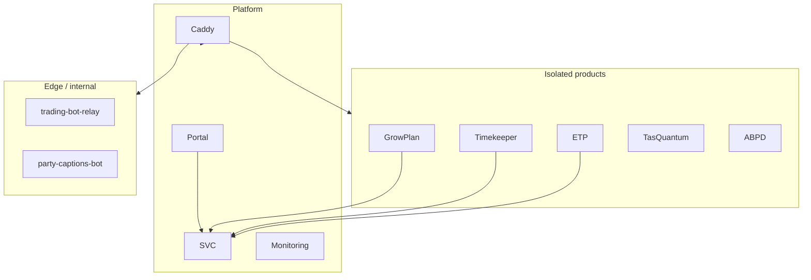

# VPS Stack Structure

**Last Updated:** 2026-10-31

**System overview:** [../integration/VPS_SYSTEM_OVERVIEW.md](../integration/VPS_SYSTEM_OVERVIEW.md)  
**Live project list:** [../integration/VPS_PROJECTS_REGISTRY.md](../integration/VPS_PROJECTS_REGISTRY.md)  
**App repos directory:** [../../projects/README.md](../../projects/README.md)  
**Host extras (WireGuard / ASA-edge):** [HOST_EDGE.md](HOST_EDGE.md)

## Current Active Components

- Reverse proxy: Caddy (`caddy` compose service) in `/vps/infrastructure/reverse-proxy` — [REVERSE_PROXY.md](REVERSE_PROXY.md)
- Monitoring: Grafana/Loki/Promtail in `/vps/infrastructure/monitoring` — [MONITORING.md](MONITORING.md)
- Hardened DB/cache/Grafana bases: `/vps/infrastructure/images/` — [HARDENED_IMAGES.md](HARDENED_IMAGES.md)
- Host hardening copies: `/vps/infrastructure/host/fail2ban/`
- Platform projects: `svc` (license server), `portal` (store/marketing)
- Product projects: `etp`, `growplan`, `timekeeper`, `tasquantum`, `abpd`, `trading-bot-relay`, `party-captions` / `party-captions-bot`
- Environment model: `production` is live; `testing` and `development` have HTTPS landing pages only (no project containers)
- Deployment tooling: `/vps/scripts`
- Security/verification reports: `/vps/reports`

## Platform vs Product Projects

| Project | Role |
|---------|------|
| `svc` | Shared license authority for all products |
| `portal` | Shared storefront, landing pages, pricing pages |
| product apps | Live apps that validate licenses against SVC (when licensed) |
| edge / internal | `trading-bot-relay`, `party-captions-bot` — not storefront products |

New licensed products integrate with both platform projects. See [LICENSING_AND_STORE_INTEGRATION.md](../integration/LICENSING_AND_STORE_INTEGRATION.md).



## Directory Layout

Every product uses **two locations**:

| Piece | Path | Contents |
|-------|------|----------|
| **Deploy config** | `/vps/environments/<env>/projects/<name>/` | `docker-compose.yml` (or `docker-compose.*.yml`), `env.*` / `.env`, Caddy snippets |
| **App source** | `/vps/projects/<name>/` | Dockerfile, application code, tests |

```text
/vps                                          # git: uhaop/vps (infra + ops)
├── environments/
│   ├── production/projects/<project>/        # deploy only
│   ├── testing/projects/                     # unused except growplan env.testing.example
│   └── development/projects/                 # empty
├── projects/                                 # application source repos
│   ├── portal/                               # submodule → uhaop/portal
│   ├── svc/                                  # submodule → uhaop/license-server
│   ├── growplan/                             # submodule → uhaop/Grow-Plan
│   ├── timekeeper/                           # submodule → uhaop/gv-timekeeper
│   ├── api/                                  # etp backend (tracked in uhaop/vps)
│   ├── tasquantum/                           # submodule → uhaop/tasquantum
│   ├── trading-bot-relay/                    # submodule → uhaop/trading-bot-relay
│   ├── abpd/                                 # own remote; not a submodule yet
│   └── README.md
├── infrastructure/
│   ├── reverse-proxy/
│   │   ├── Caddyfile
│   │   ├── docker-compose.yml   # service: caddy, container: vps-reverse-proxy
│   │   ├── .env                 # GRAFANA_EDGE_* (see REVERSE_PROXY.md)
│   │   ├── ssl/{domain}/
│   │   └── certbot-webroot/     # ACME + party-captions static
│   ├── monitoring/
│   │   ├── docker-compose.yml   # loki, promtail, grafana
│   │   ├── .env                 # GRAFANA_ADMIN_PASSWORD (see MONITORING.md)
│   │   ├── loki-config.yml
│   │   └── promtail-config.yml
│   ├── images/                  # Hardened base Dockerfiles
│   │   ├── postgres/
│   │   ├── redis8/
│   │   └── grafana/
│   └── host/fail2ban/           # jail snippets synced to the OS
├── scripts/
└── templates/new-project-template/
```

### App source layout

All product and platform app repos live under `projects/<name>/`. Deploy folders under `environments/<env>/projects/<name>/` hold compose and env files only. **etp** API is tracked in `projects/api` (not a separate repo).

### Compose link

From `environments/production/projects/<name>/docker-compose.yml`:

```yaml
build:
  context: ../../../../projects/<name>
```

ETP is `../../../../projects/api`. GrowPlan splits backend vs `frontend/` contexts. Party Captions bot uses a GHCR image (no local build context).

## Git strategy for `projects/`

| App type | Recommended tracking |
|----------|---------------------|
| New standalone app | Git submodule at `projects/<name>` |
| Fresh VPS | `git clone --recurse-submodules` or `/vps/scripts/ensure-project-repos.sh` |
| ABPD | Own remote at `projects/abpd`; VPS branch `vps-abpd-staging` — see [../../projects/README.md](../../projects/README.md) |

See [../../projects/README.md](../../projects/README.md) and [../maintenance/GIT_PULL_SAFETY.md](../maintenance/GIT_PULL_SAFETY.md).

## Routing Model

- Shared path-based host: `app.graspvisual.com` (`/etp`, `/svc`, `/grafana`, `/trading-bot-relay`, `/party-captions`).
- Custom domains use site blocks in the canonical `Caddyfile`: `growplan.app`, `time.graspvisual.com`, `store.graspvisual.com`, `www.tasquantum.com`, `abpd.graspvisual.com`.
- Testing/dev hosts exist for future path-based apps; they serve landing HTML today.

## n8n Status

n8n is decommissioned from active setup and onboarding flows.

- Reference tracker: `/vps/docs/security/N8N_DECOMMISSION_REFERENCE_TRACKER.md`
